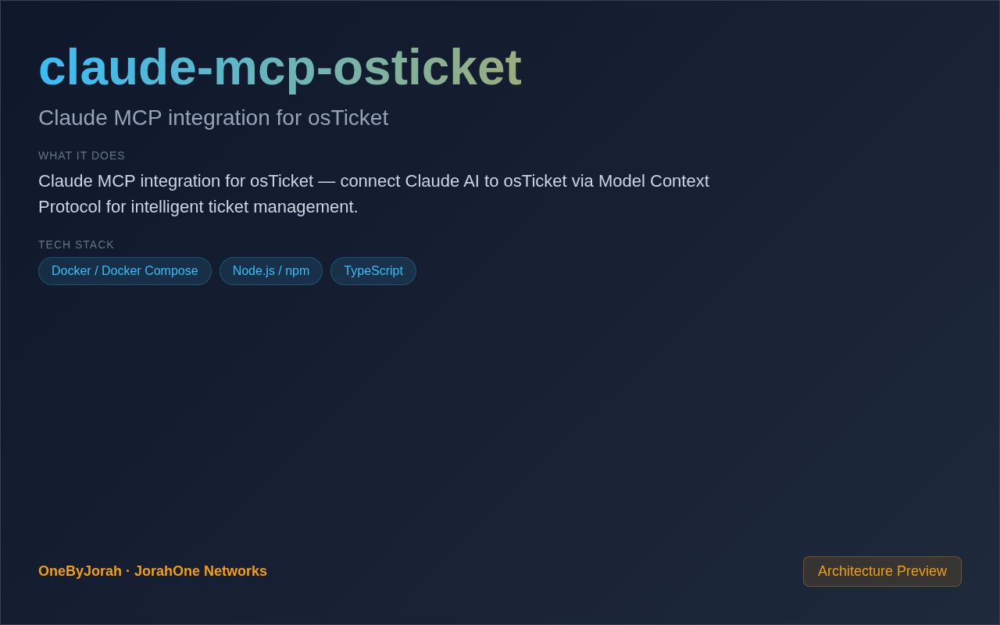

<div align="center">


# claude-mcp-osticket

Claude MCP integration for osTicket


</div>

---

<p align="center">
  
</p>

**Model Context Protocol Server for osTicket integration in Claude Code** - Manage support tickets directly from your AI assistant.

## 📸 Screenshot

This is a CLI/backend-only tool. No screenshots available.

## 📖 Documentation

**📚 [Complete Documentation & FAQ](https://faq.markus-michalski.net/en/mcp/osticket)**

The comprehensive guide includes:
- Installation instructions
- Configuration examples
- All 12 MCP tools with parameters
- Troubleshooting guide
- Best practices & workflows

## ⚡ Quick Start

```bash
# 1. Clone repository
git clone https://github.com/OneByJorah/claude-mcp-osticket.git ~/.claude/mcp-servers/osticket

# 2. Install dependencies
cd ~/.claude/mcp-servers/osticket
npm install

# 3. Configure environment
cp .env.example .env
# Edit .env with your osTicket API credentials

# 4. Build TypeScript
npm run build

# 5. Restart Claude Code
```

## 🔑 Requirements

- **Node.js 18+**
- **osTicket instance** with REST API enabled
- **[API Endpoints Plugin](https://github.com/markus-michalski/osticket-plugins/tree/main/api-endpoints)** installed on osTicket
- **osTicket API Key** with appropriate permissions

## 🛠️ Available Tools

### Core Ticket Management
- `get_ticket` - Retrieve complete tickets with all messages
- `list_tickets` - List tickets with filters (status, department, pagination)
- `search_tickets` - Full-text search across ticket subjects and numbers
- `get_ticket_stats` - Get aggregated ticket statistics
- `create_ticket` - Create new tickets with Markdown support
- `update_ticket` - Modify ticket properties (status, department, assignee, etc.)
- `delete_ticket` - Permanently delete tickets

### Subticket Management (NEW)
- `get_parent_ticket` - Get parent ticket of a subticket
- `get_child_tickets` - Get list of child tickets (subtickets)
- `create_subticket_link` - Create parent-child relationship between tickets
- `unlink_subticket` - Remove parent-child relationship

### Attachment Operations
- `download_attachment` - Download ticket attachments to local temp files

**Note:** Subticket tools require the [Subticket Manager Plugin](https://github.com/markus-michalski/osticket-plugins/tree/main/subticket-manager) to be installed and active on osTicket.

## 🔀 Fork Notes

This repository is a fork of [markus-michalski/claude-mcp-osTicket](https://github.com/markus-michalski/claude-mcp-osTicket) maintained by **OneByJorah**.

**Changes from upstream:**
- Added `Dockerfile` for containerized MCP server deployment
- `.env.example` already present (unchanged)

## 📄 License

MIT License - See [LICENSE](./LICENSE) for details

## 👤 Author

**Original Author:** Markus Michalski
- Website: [markus-michalski.net](https://markus-michalski.net)
- GitHub: [@markus-michalski](https://github.com/markus-michalski)

**JorahOne Maintainer:** Jhonattan L. Jimenez
- GitHub: [@OneByJorah](https://github.com/OneByJorah)

## 🔗 Links

- **[📚 Full Documentation](https://faq.markus-michalski.net/en/mcp/osticket)** (English)
- **[📚 Vollständige Dokumentation](https://faq.markus-michalski.net/de/mcp/osticket)** (Deutsch)
- [API Endpoints Plugin](https://github.com/markus-michalski/osticket-plugins/tree/main/api-endpoints)
- [Changelog](./CHANGELOG.md)

## 🤝 Contributing

See [CONTRIBUTING.md](CONTRIBUTING.md). All contributions follow the [Code of Conduct](CODE_OF_CONDUCT.md).

## 🔒 Security

Found a vulnerability? Please follow our [Security Policy](SECURITY.md) and report privately to `security@jorahone.com`.

## 📄 License

[MIT License](LICENSE) © Jhonattan L. Jimenez (OneByJorah)

---

<p align="center">Built with 🌴 by <a href="https://github.com/OneByJorah">OneByJorah</a> · <a href="https://jorahone.com">jorahone.com</a></p>
